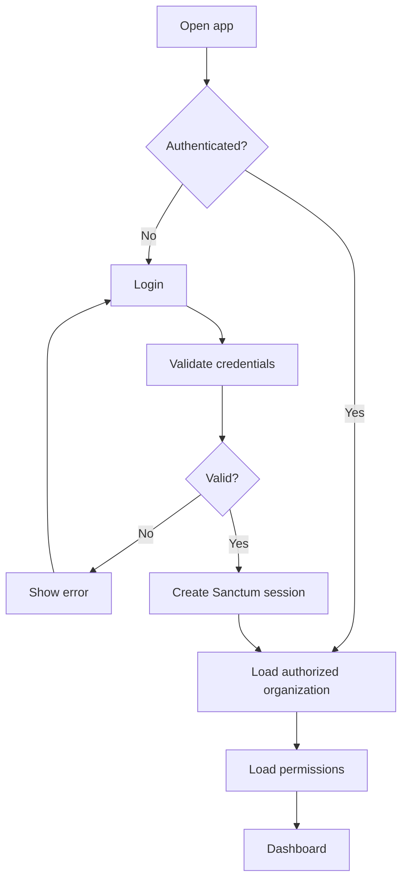
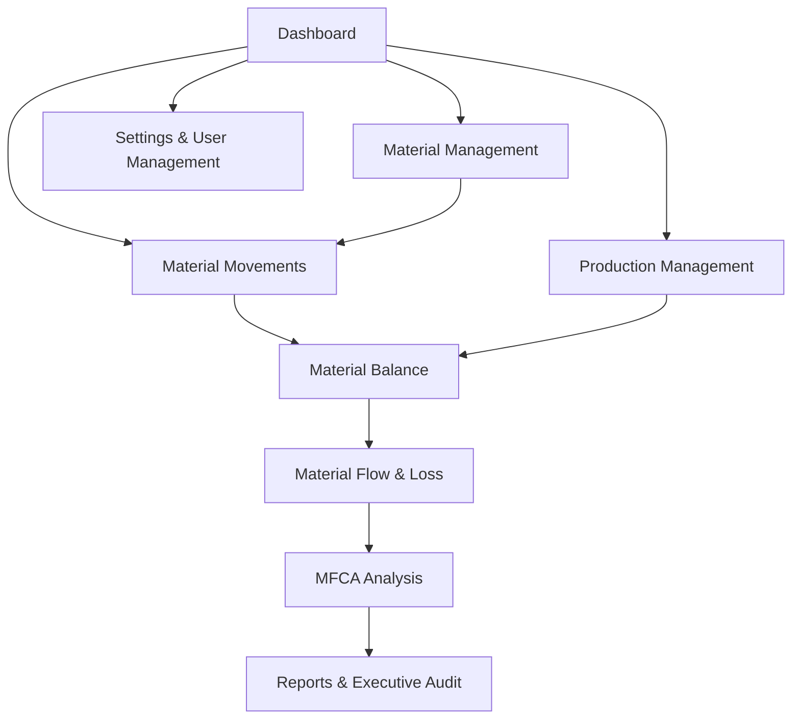
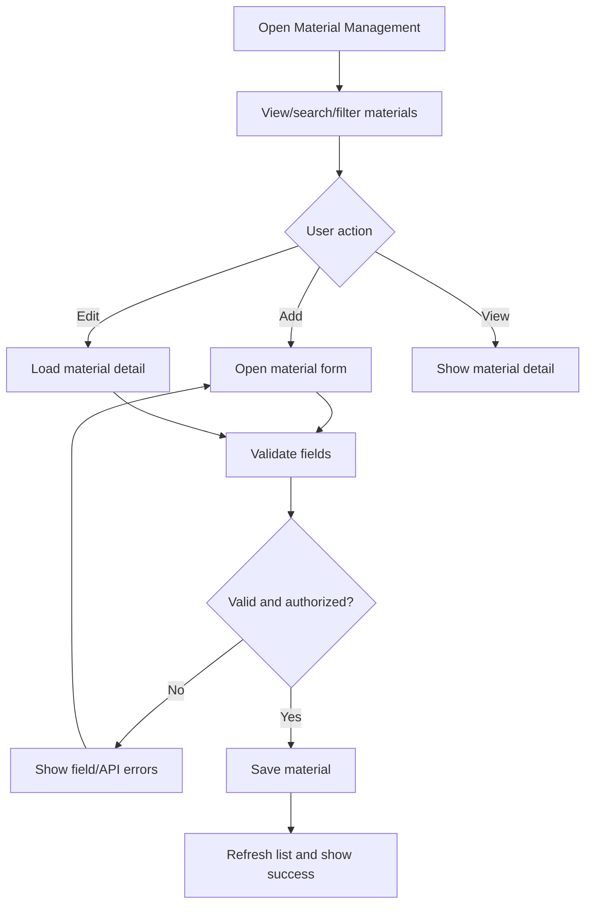
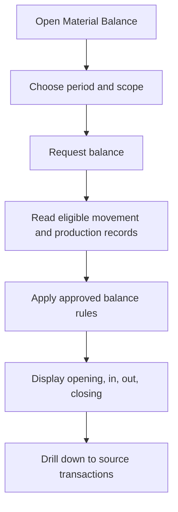
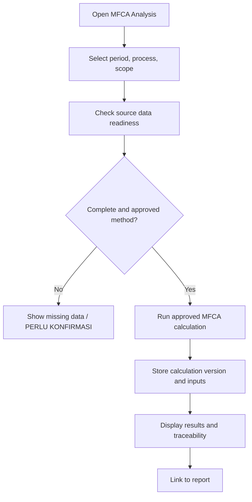
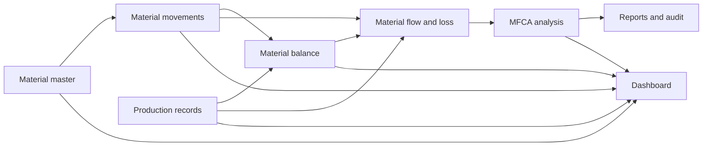

# 03 — User Flow & Interaction Specification
## JejakMaterial

**Status:** rancangan alur awal. Alur persetujuan, status posting, dan hak akses final berstatus **PERLU KONFIRMASI**.

## 1. Prinsip
Alur mengikuti sembilan halaman pada referensi. Setiap aksi yang mengubah data harus melewati autentikasi, otorisasi backend, validasi, transaksi database, dan feedback UI. Perhitungan saldo, flow, dan MFCA membaca data sumber; pengguna tidak mengedit hasil hitung secara langsung kecuali ada mekanisme koreksi yang disepakati.

## 2. Authentication Flow
**Trigger:** pengguna membuka aplikasi atau sesi berakhir.

- Input: email/username dan password sesuai kebijakan akun.
- Proses: backend memvalidasi kredensial, sesi/token, status akun, dan izin.
- Success: pengguna diarahkan ke halaman pertama yang diizinkan (default Dashboard).
- Error: kredensial salah, akun nonaktif, sesi kedaluwarsa, atau akses tidak tersedia.
- **PERLU KONFIRMASI:** login email atau username; invitation/reset password; MFA; mode cookie Sanctum atau token untuk arsitektur domain.

## 3. Global Navigation Flow

Diagram menunjukkan hubungan konseptual, bukan urutan wajib. Pengguna dapat membuka modul sesuai izin dan kebutuhan.

## 4. Dashboard Flow
- Trigger: pengguna memilih Dashboard atau login berhasil.
- Action: pilih periode/lokasi jika filter tersedia.
- Process: backend mengambil agregasi dari data yang sudah tersimpan dan terotorisasi.
- Validation: rentang tanggal valid; konteks organisasi jelas.
- Success: KPI, ringkasan, atau tren ditampilkan dengan unit dan periode.
- Error: tampilkan kegagalan pemuatan per bagian; jangan mengganti error dengan angka nol.
- Destination: pengguna dapat menuju modul sumber dari ringkasan bila tautan drill-down disetujui.

## 5. Material Management Flow

- Input kandidat: kode, nama, kategori, satuan, deskripsi, status.
- Validasi: kode unik per organisasi; satuan dan kategori aktif; field wajib.
- Success: data muncul di daftar.
- Error: duplikasi kode, field invalid, konflik update.
- **PERLU KONFIRMASI:** field final, status aktif/nonaktif, aturan penghapusan, barcode, spesifikasi material.

## 6. Material Movements Flow
- Trigger: pengguna membuka Material Movements lalu memilih tambah transaksi.
- Action: memilih jenis pergerakan, material, tanggal, jumlah, satuan, lokasi asal/tujuan, dan referensi.
- Process: backend memvalidasi referensi dan menyimpan transaksi; bila posting digunakan, perhitungan saldo diperbarui secara konsisten.
- Validation: kuantitas > 0; material/lokasi valid; unit kompatibel; tanggal dalam periode terbuka.
- Success: transaksi tampil pada riwayat dan memengaruhi saldo sesuai aturan.
- Error: stok tidak cukup (jika larangan stok negatif disetujui), periode tertutup, referensi tidak valid.
- **PERLU KONFIRMASI:** tipe transaksi, approval, status draft/posted, transfer antar lokasi, reversal, dan aturan stok negatif.

## 7. Production Management Flow
- Trigger: pengguna membuka modul produksi dan membuat catatan batch/perintah produksi.
- Input kandidat: nomor batch, tanggal, produk/output, lini/lokasi, material input, kuantitas output, produk samping, dan residu/loss.
- Process: validasi material dan satuan; simpan header serta detail input/output secara atomik.
- Success: catatan produksi tampil; data tersedia untuk rekonsiliasi.
- Error: batch duplikat, input tidak lengkap, unit tidak cocok, periode tertutup.
- **PERLU KONFIRMASI:** model batch, BOM, pencatatan aktual vs standar, output parsial, scrap, rework, dan approval.

## 8. Material Balance Flow

- Sistem menghitung saldo dari transaksi sumber; saldo tidak boleh menjadi input manual yang memutus traceability.
- Rumus kuantitas final bergantung pada jenis transaksi dan status yang disetujui.
- **PERLU KONFIRMASI:** saldo awal, cut-off periode, unit conversion, stock adjustment, dan stok negatif.

## 9. Material Flow & Loss Flow
- Trigger: pengguna memilih periode/proses/lokasi.
- Action: menerapkan filter dan membuka detail aliran.
- Process: backend menghubungkan data input produksi, output, produk samping, residu, dan kehilangan berdasarkan definisi yang disetujui.
- Validation: sumber data lengkap; unit sebanding; periode sama.
- Success: diagram/tabel flow menampilkan nilai dan asal data.
- Error: data tidak lengkap atau tidak dapat direkonsiliasi; tampilkan status kualitas data.
- **PERLU KONFIRMASI:** definisi loss, batas proses, klasifikasi output, metode estimasi, toleransi selisih.

## 10. MFCA Analysis Flow

- Jangan menjalankan formula atau alokasi biaya yang belum disetujui.
- Setiap hasil harus menyimpan versi metode, parameter, periode, sumber, dan waktu kalkulasi.
- **PERLU KONFIRMASI:** standar acuan, quantity center, material/energy/system costs, cost allocation, output positif/negatif, dan pembulatan.

## 11. Reports & Executive Audit Flow
- Trigger: pengguna memilih laporan dan periode.
- Action: memilih jenis laporan, filter, format ekspor.
- Process: backend memeriksa izin, mengambil data konsisten, dan membuat hasil.
- Validation: periode, organisasi, dan filter valid.
- Success: pratinjau atau file laporan tersedia; parameter dan timestamp dicatat.
- Error: data tidak cukup, izin tidak memadai, proses ekspor gagal.
- **PERLU KONFIRMASI:** format PDF/XLSX/CSV, template laporan, tanda tangan, snapshot, dan retensi arsip.

## 12. Settings & User Management Flow
- Trigger: admin membuka Settings & User Management.
- Action: mengelola profil, pengguna, role, permission, atau konfigurasi yang diizinkan.
- Process: backend memvalidasi kewenangan; perubahan sensitif dicatat.
- Validation: email unik sesuai cakupan, role valid, admin tidak mengunci dirinya sendiri tanpa prosedur.
- Success: daftar dan detail diperbarui.
- Error: akses ditolak, konflik data, role tidak valid.
- **PERLU KONFIRMASI:** invitation, reset akun, pengelolaan organisasi, konfigurasi lokasi, serta pemisahan permission granular.

## 13. Shared Interaction States
Semua halaman data harus memiliki:
- Loading state saat request berjalan.
- Empty state saat belum ada data.
- Error state dengan tindakan pemulihan yang aman.
- Success feedback setelah perubahan berhasil.
- Form validation di client dan server.
- Confirmation untuk tindakan destruktif.
- Pagination, search, sorting, filter jika memang tersedia di UI dan dibutuhkan.
- Penanganan konflik update dan sesi kedaluwarsa.

## 14. Cross-Module Data Flow

Hubungan tersebut merupakan model data konseptual. Dashboard/report hanya menampilkan agregat yang memiliki definisi dan sumber jelas.
