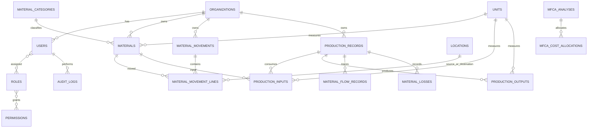

# 04 — Database Schema & ERD
## JejakMaterial — MySQL

**Status:** logical schema proposal. Entitas kandidat dari master prompt dievaluasi; bukan semua kandidat otomatis menjadi tabel final. Detail proses perlu dikonfirmasi.

## 1. Database Principles
- MySQL dengan InnoDB dan foreign key.
- Gunakan `BIGINT UNSIGNED` untuk ID internal atau UUID/ULID jika dipilih konsisten.
- Gunakan `DECIMAL`, bukan floating point, untuk kuantitas dan uang.
- Simpan timestamp dalam UTC; tampilkan sesuai zona waktu organisasi.
- Setiap data bisnis memiliki `organization_id` bila multi-tenant disetujui.
- Transaksi sumber tidak dihapus permanen setelah dipakai perhitungan; gunakan reversal/void dengan audit.
- Simpan snapshot/versi metode untuk hasil analisis yang harus reproducible.

## 2. Proposed Entities
Status:
- **Core proposal:** dibutuhkan secara konseptual untuk fungsi yang disebut.
- **Conditional:** hanya dibuat jika aturan bisnis memerlukannya.
- **PERLU KONFIRMASI:** definisi final belum tersedia.

| Tabel | Status | Fungsi |
|---|---|---|
| organizations | Conditional, direkomendasikan jika multi-tenant | Batas data perusahaan |
| users | Core | Akun pengguna |
| roles | Core | Peran |
| permissions | Core | Izin granular |
| role_permissions | Core | Relasi many-to-many |
| user_roles | Conditional | Multi-role bila diperlukan |
| material_categories | Core proposal | Klasifikasi material |
| units | Core | Satuan |
| materials | Core | Master material |
| locations | Conditional | Gudang/pabrik/lokasi |
| material_movements | Core | Header transaksi pergerakan |
| material_movement_lines | Conditional | Detail baris jika satu transaksi berisi banyak material |
| production_records | Core | Header catatan produksi |
| production_inputs | Core | Material input produksi |
| production_outputs | Core | Produk/output dan residu bila dimodelkan |
| material_balances | Conditional/cache | Snapshot saldo; bukan sumber kebenaran transaksi |
| material_flow_records | Conditional | Snapshot/hasil pemetaan flow bila perlu disimpan |
| material_losses | Conditional | Detail loss terdefinisi |
| mfca_analyses | Core proposal | Satu run analisis MFCA |
| mfca_cost_allocations | Conditional | Detail alokasi setelah metode disetujui |
| reports | Conditional | Metadata hasil laporan |
| audit_logs | Core | Jejak aktivitas penting |

## 3. Table Definitions
Kolom umum: `id`, `created_at`, `updated_at`; soft delete hanya untuk master data yang aman dinonaktifkan. Gunakan `deleted_at` bila diperlukan dan jangan menerapkannya pada transaksi ledger tanpa desain reversal.

### 3.1 `organizations` (conditional)
| Kolom | Tipe | Null | Keterangan |
|---|---|---|---|
| id | BIGINT UNSIGNED PK | No | ID |
| name | VARCHAR(160) | No | Nama perusahaan |
| code | VARCHAR(50) | No | Unik |
| timezone | VARCHAR(64) | No | Default organisasi |
| created_at / updated_at | TIMESTAMP | Yes | Audit waktu |

### 3.2 `users`
| Kolom | Tipe | Null | Keterangan |
|---|---|---|---|
| id | BIGINT UNSIGNED PK | No | ID |
| organization_id | BIGINT UNSIGNED FK | Conditional | Tenant |
| name | VARCHAR(160) | No | Nama tampilan |
| email | VARCHAR(190) | No | Unik sesuai kebijakan |
| password | VARCHAR(255) | No | Hash |
| is_active | BOOLEAN | No | Default true |
| email_verified_at | TIMESTAMP | Yes | Verifikasi |
| created_at / updated_at | TIMESTAMP | Yes | Waktu |

### 3.3 `roles`, `permissions`, `role_permissions`, `user_roles`
- `roles`: `id`, `organization_id` nullable, `name`, `code`, timestamps; unique `(organization_id, code)`.
- `permissions`: `id`, `code` unique, `description`.
- `role_permissions`: `role_id` FK, `permission_id` FK, composite PK.
- `user_roles`: `user_id` FK, `role_id` FK, composite PK; hanya bila multi-role diaktifkan.

### 3.4 `material_categories`, `units`, `materials`
- `material_categories`: `id`, `organization_id`, `name`, `code`, `description`, `is_active`, timestamps.
- `units`: `id`, `code`, `name`, `symbol`, `dimension`; daftar unit dasar.
- `materials`: `id`, `organization_id`, `category_id` FK, `base_unit_id` FK, `code`, `name`, `description`, `is_active`, timestamps.
- Index/unique: `(organization_id, code)` pada materials; index `category_id`, `base_unit_id`.
- **PERLU KONFIRMASI:** konversi unit, densitas, grade, spesifikasi, dan material lot/batch.

### 3.5 `locations` (conditional)
`id`, `organization_id` FK, `code`, `name`, `location_type`, `is_active`, timestamps. Unique `(organization_id, code)`. Diperlukan bila pencatatan multi-gudang/pabrik.

### 3.6 `material_movements`
| Kolom | Tipe | Null | Keterangan |
|---|---|---|---|
| id | BIGINT UNSIGNED PK | No | ID transaksi |
| organization_id | BIGINT UNSIGNED FK | Conditional | Tenant |
| movement_number | VARCHAR(64) | No | Nomor unik per organisasi |
| movement_type | VARCHAR(40) | No | Enum bisnis perlu disepakati |
| movement_date | DATETIME | No | Waktu transaksi |
| status | VARCHAR(24) | No | Draft/posted/reversed perlu konfirmasi |
| reference_type | VARCHAR(60) | Yes | Referensi sumber |
| reference_id | BIGINT UNSIGNED | Yes | ID sumber |
| created_by | BIGINT UNSIGNED FK users | No | Pembuat |
| posted_at | DATETIME | Yes | Waktu posting |
| created_at / updated_at | TIMESTAMP | Yes | Waktu |

`material_movement_lines` bila transaksi multi-material: `id`, `movement_id` FK, `material_id` FK, `from_location_id` FK nullable, `to_location_id` FK nullable, `quantity DECIMAL(20,6)`, `unit_id` FK, `unit_cost DECIMAL(20,6)` nullable, timestamps. **PERLU KONFIRMASI:** apakah satu transaksi memiliki banyak baris dan apakah unit cost disimpan.

### 3.7 `production_records`, `production_inputs`, `production_outputs`
- `production_records`: `id`, `organization_id`, `production_number`, `process_code`, `production_date`, `status`, `created_by`, timestamps.
- `production_inputs`: `id`, `production_record_id`, `material_id`, `quantity DECIMAL(20,6)`, `unit_id`, `source_movement_line_id` nullable.
- `production_outputs`: `id`, `production_record_id`, `output_material_id` nullable, `output_name`, `output_type`, `quantity DECIMAL(20,6)`, `unit_id`.
- Index: tenant + date; FK untuk seluruh referensi.
- **PERLU KONFIRMASI:** produk jadi dimodelkan sebagai material atau entitas product tersendiri; klasifikasi by-product, scrap, waste, dan rework.

### 3.8 `material_balances` (conditional/cache)
Snapshot opsional: `id`, `organization_id`, `location_id`, `material_id`, `period_start`, `period_end`, `opening_quantity`, `in_quantity`, `out_quantity`, `closing_quantity`, `calculated_at`, `source_version`. Unique sesuai kombinasi scope/periode. Nilai harus dapat dibangun ulang dari ledger transaksi. Jangan jadikan tabel ini satu-satunya sumber saldo.

### 3.9 `material_flow_records` dan `material_losses` (conditional)
`material_flow_records`: `id`, `organization_id`, `production_record_id`, `flow_type`, `source_entity_type`, `source_entity_id`, `quantity`, `unit_id`, `calculation_version`, timestamps.
`material_losses`: `id`, `organization_id`, `production_record_id`, `loss_category`, `quantity`, `unit_id`, `valuation_amount` nullable, `method_version`, timestamps.
Keduanya hanya difinalisasi setelah definisi flow/loss dan aturan pengukuran disepakati. Hindari menyimpan ulang data yang dapat dihitung tanpa alasan audit/performa.

### 3.10 `mfca_analyses`, `mfca_cost_allocations`
- `mfca_analyses`: `id`, `organization_id`, `analysis_number`, `period_start`, `period_end`, `scope_type`, `scope_id`, `method_version`, `status`, `input_snapshot JSON`, `result_snapshot JSON`, `created_by`, `calculated_at`.
- `mfca_cost_allocations`: `id`, `mfca_analysis_id`, `cost_category`, `cost_source`, `allocation_basis`, `allocated_amount DECIMAL(20,4)`, `currency_code`, `notes`.
- **PERLU KONFIRMASI KRITIS:** kategori biaya, metode alokasi, basis kuantitas, currency, pembulatan, dan standar MFCA.

### 3.11 `reports`, `audit_logs`
- `reports`: `id`, `organization_id`, `report_type`, `parameters JSON`, `file_path` nullable, `generated_by`, `generated_at`, `status`.
- `audit_logs`: `id`, `organization_id`, `actor_user_id`, `action`, `entity_type`, `entity_id`, `before_data JSON` nullable, `after_data JSON` nullable, `ip_address` nullable, `created_at`.
Batasi data sensitif pada audit log; jangan menyimpan password/token.

## 4. ERD (Logical)

ERD bersifat logical; relasi organisasi dan lokasi yang conditional harus disesuaikan setelah keputusan multi-tenant/multi-site.

## 5. Relationship Summary
- Organization 1:N users, materials, transactions, production, analyses.
- Role M:N permission.
- User M:N role jika multi-role.
- Category 1:N material; unit 1:N material/quantity record.
- Movement 1:N movement lines; material 1:N movement lines.
- Production record 1:N inputs and outputs.
- MFCA analysis 1:N cost allocations.
- User 1:N audit logs.

## 6. Index & Integrity
Index minimum:
- Unique `(organization_id, code)` untuk material.
- Unique `(organization_id, movement_number)`.
- Index `(organization_id, movement_date, status)`.
- Index `(organization_id, production_date, status)`.
- Index FK seluruh tabel detail.
- Index `(organization_id, period_start, period_end)` pada analisis/laporan.

Aturan:
- Gunakan FK `RESTRICT` untuk referensi transaksi yang sudah digunakan.
- Gunakan transaction DB saat menyimpan header dan detail.
- Gunakan idempotency key untuk endpoint posting jika diperlukan.
- Cegah duplikasi request posting.
- Tenant ID berasal dari konteks autentikasi, bukan dipercaya dari body request.

## 7. Open Questions
1. Multi-tenant dan multi-site sejak awal?
2. Perlukah lot/batch/serial material?
3. Apakah movement header bisa memuat banyak material?
4. Metode penilaian biaya persediaan?
5. Model output produksi dan klasifikasi residu?
6. Perlu approval dan posting?
7. Formula material balance dan cut-off periode?
8. Definisi data yang disimpan sebagai snapshot?
9. Standar dan versi metode MFCA?
10. Mata uang dan aturan pembulatan?

## 8. Migration Strategy
Bangun migration bertahap: identity/RBAC → master data → movement → production → balance read model → flow/loss → MFCA → reports/audit. Jangan membuat tabel conditional sebelum kebutuhan bisnis dikonfirmasi.
