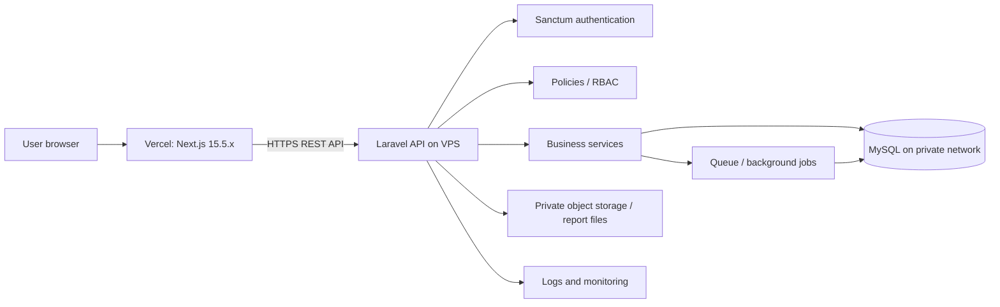

# 07 — Technical Specification & System Architecture
## JejakMaterial

## 1. System Overview
Aplikasi terdiri dari frontend Next.js 15.5.x di Vercel, backend Laravel di VPS, dan database MySQL di VPS/private network. Frontend berkomunikasi dengan backend melalui REST API `/api/v1`. Laravel menangani autentikasi Sanctum, authorization, validasi, business logic, audit, dan akses database.

## 2. Mandatory Technology Constraints
| Layer | Technology | Version policy |
|---|---|---|
| Frontend | Next.js | **15.5.x wajib** |
| UI | React + TypeScript | Versi kompatibel dengan Next.js 15.5.x; pin saat setup |
| Routing | Next.js App Router | Wajib |
| Styling | Tailwind CSS | Pilih versi yang kompatibel dan pin |
| Backend | Laravel + PHP | Pilih versi Laravel/PHP yang saling kompatibel dan masih mendapat security support; **PERLU KONFIRMASI versi minor final** |
| Database | MySQL | Pilih versi LTS/stabil yang didukung Laravel |
| Authentication | Laravel Sanctum | Wajib |
| Frontend hosting | Vercel | Wajib |
| Backend/database hosting | VPS | Wajib |

Jangan mengganti Next.js 15.5.x ke 14 atau 16. Sebelum implementasi, verifikasi matriks kompatibilitas dependency dan dokumentasi resmi versi yang dipilih. Catat versi persis di `package.json`, lockfile, `composer.lock`, dan dokumen deployment.

## 3. Architecture Diagram

Object storage, queue worker, dan monitoring adalah komponen rekomendasi; pemilihan layanan final perlu disesuaikan kebutuhan/biaya.

## 4. Frontend Architecture
Gunakan App Router dan pemisahan berdasarkan fitur:
```text
frontend/
├── app/
│   ├── (auth)/
│   │   └── login/
│   ├── (app)/
│   │   ├── layout.tsx
│   │   ├── dashboard/
│   │   ├── material-management/
│   │   ├── material-movements/
│   │   ├── production-management/
│   │   ├── material-balance/
│   │   ├── material-flow-loss/
│   │   ├── mfca-analysis/
│   │   ├── reports-executive-audit/
│   │   └── settings-user-management/
│   ├── globals.css
│   └── layout.tsx
├── components/
│   ├── layout/
│   ├── data-display/
│   ├── forms/
│   └── feedback/
├── features/
│   ├── materials/
│   ├── movements/
│   ├── production/
│   ├── balances/
│   ├── flows/
│   ├── mfca/
│   ├── reports/
│   └── users/
├── lib/
│   ├── api/
│   ├── auth/
│   ├── validation/
│   └── utils/
├── types/
└── tests/
```
Gunakan Server Components untuk konten yang tidak membutuhkan interaksi client; Client Components hanya untuk interaksi/state browser. Hindari menaruh seluruh aplikasi dalam satu client component.

## 5. Backend Architecture
Rekomendasi struktur Laravel:
```text
  
```
Controller menangani HTTP orchestration; Form Request validasi; Policy authorization; Service/Action menjalankan business logic; Resource membentuk response. Hindari business logic berat di controller/model event.

## 6. Database Architecture
- MySQL InnoDB.
- Migration sebagai sumber skema.
- Foreign key dan index dirancang sejak awal.
- Decimal untuk kuantitas/biaya.
- Tenant scoping konsisten jika multi-tenant.
- Snapshot analisis menyimpan versi metode dan parameter.
- Backup harian minimal sebagai rekomendasi awal; frekuensi dan retensi final **PERLU KONFIRMASI**.
- Uji restore, bukan hanya keberhasilan backup.

## 7. Authentication Architecture
Sanctum mendukung SPA cookie-based atau personal access token. Untuk frontend Vercel dan backend VPS, tentukan domain/subdomain, CORS, cookie domain, SameSite, Secure, CSRF, dan credentials sebelum memilih mode. Rekomendasi awal untuk first-party web app adalah cookie-based SPA Sanctum bila domain dan deployment dapat dikonfigurasi aman. Jangan menyimpan session token di localStorage.

## 8. Authorization & RBAC
- Gunakan Laravel Policies/Gates.
- Permission diperiksa di backend untuk setiap operasi.
- Frontend memakai permission hanya untuk mengatur visibilitas dan UX.
- Semua query bisnis wajib dibatasi tenant.
- Audit perubahan role dan permission.
- Uji IDOR dan akses lintas organisasi.

## 9. API Communication
- REST JSON `/api/v1`.
- Client API terpusat di `lib/api`.
- Normalisasi error response.
- Timeout dan retry hanya untuk request idempotent.
- Mutasi non-idempotent menggunakan idempotency key jika risiko double-submit tinggi.
- Pagination, filter, sort dilakukan server-side.

## 10. State Management
Mulai dari React state untuk state lokal. Gunakan URL search params untuk filter yang perlu dibagikan. Untuk server data, gunakan fetch/cache strategy Next.js atau library query yang dipilih setelah kebutuhan invalidation ditetapkan. Hindari state global sebelum ada kebutuhan nyata.

## 11. Component Architecture
Pisahkan:
- UI primitives (button, input, dialog).
- Shared application components (table, filter bar, page header).
- Feature components (movement form, MFCA result panel).
- Business services di backend, bukan komponen UI.
Jangan membuat abstraksi generik sebelum ada pola berulang yang jelas.

## 12. Environment Variables
Frontend (contoh nama):
```env
NEXT_PUBLIC_API_BASE_URL=https://api.example.com/api/v1
```
Backend (contoh nama):
```env
APP_ENV=production
APP_DEBUG=false
APP_URL=https://api.example.com
DB_CONNECTION=mysql
DB_HOST=127.0.0.1
DB_PORT=3306
DB_DATABASE=jejakmaterial
DB_USERNAME=<secret>
DB_PASSWORD=<secret>
SANCTUM_STATEFUL_DOMAINS=app.example.com
SESSION_SECURE_COOKIE=true
```
Nilai produksi disimpan di secret manager/hosting environment, bukan repository. Jangan pernah memberi prefix `NEXT_PUBLIC_` pada secret.

## 13. Security Requirements
- HTTPS untuk seluruh trafik.
- `APP_DEBUG=false` di produksi.
- Password hashing Laravel.
- CSRF/CORS dikonfigurasi ketat.
- Rate limit login dan endpoint sensitif.
- Validasi input dan output encoding.
- Proteksi mass assignment.
- Least privilege untuk database user.
- Database tidak diekspos langsung ke internet.
- Backup terenkripsi dan akses terbatas.
- Log tidak menyimpan password, token, atau data rahasia.
- Dependency audit dan patch security rutin.
- File report diakses melalui endpoint terotorisasi atau signed URL terbatas.

## 14. Performance
- Pagination server-side.
- Index berdasarkan query aktual.
- Hindari N+1 dengan eager loading terukur.
- Cache hanya data agregat yang aman dan invalidasinya jelas.
- Gunakan queue untuk laporan/analisis berat.
- Pantau query lambat dan ukuran payload.
- Jangan mengoptimalkan dengan menyimpan duplikasi data tanpa strategi konsistensi.

## 15. Error Handling
Gunakan envelope API konsisten. Frontend membedakan validation, auth, permission, conflict, network, dan server error. Pesan untuk pengguna tidak menampilkan stack trace. Simpan request ID untuk korelasi log.

## 16. Deployment Architecture
### Frontend — Vercel
- Build dengan Node runtime yang kompatibel dan dipin.
- Environment variables per environment.
- Preview deployment untuk pull request.
- Domain frontend HTTPS.

### Backend — VPS
- Nginx + PHP-FPM.
- Laravel production config dan `APP_DEBUG=false`.
- Queue worker bila queue dipakai.
- Scheduler/cron bila diperlukan.
- Firewall hanya membuka port layanan publik yang diperlukan.
- SSH key, non-root deployment user, patch OS rutin.

### Database — VPS
- MySQL bind ke localhost/private network.
- User aplikasi dengan privilege minimum.
- Backup otomatis, retensi, dan uji restore.
- Monitor disk, connection, slow query.

## 17. Logging & Monitoring
Catat error aplikasi, request ID, waktu respons, queue failure, database health, dan deployment. Hindari menyimpan payload sensitif. Tetapkan alert untuk disk penuh, backup gagal, queue menumpuk, dan error rate tinggi.

## 18. Backup & Recovery
Rekomendasi awal: backup database harian dan backup sebelum migration besar; simpan salinan terenkripsi di lokasi terpisah dari VPS. Tetapkan RPO/RTO dan retensi bersama pemilik sistem. Lakukan restore drill berkala.

## 19. Testing Strategy
- Frontend: component/UI tests dan Playwright E2E.
- Backend: PHPUnit/Pest untuk unit, feature, policy, API.
- Database: migration test, FK/integrity, transaction rollback.
- Security: tenant isolation, IDOR, role bypass, CSRF/CORS.
- MFCA: golden test hanya setelah formula dan contoh kasus disahkan.

## 20. Dependency & Version Governance
- Pin versi dependency.
- Commit lockfile.
- Jangan upgrade Next.js melewati 15.5.x.
- Verifikasi React/Tailwind/plugin kompatibilitas sebelum update.
- Catat alasan perubahan dependency.
- Jalankan lint, typecheck, tests, dan build pada CI.

## 21. Open Technical Decisions
1. Versi Laravel/PHP/MySQL minor yang dipilih?
2. Cookie-based Sanctum atau token?
3. Domain frontend/API dan strategi CORS/CSRF?
4. Queue driver dan object storage?
5. Strategi multi-tenant (shared schema dengan organization_id atau alternatif)?
6. Target RPO/RTO, backup retention, dan monitoring?
7. Apakah laporan perlu background processing?
